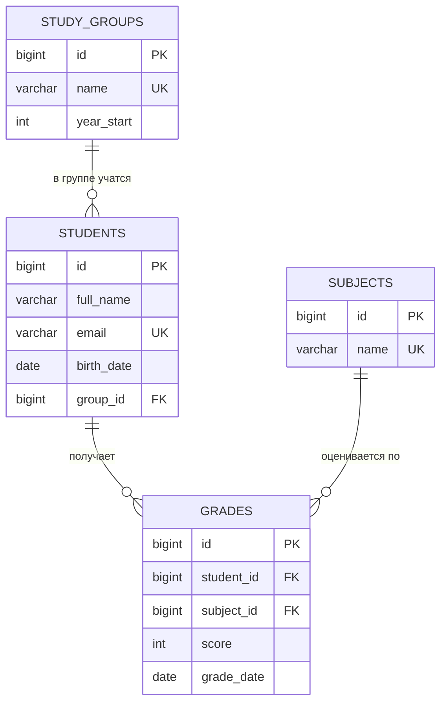
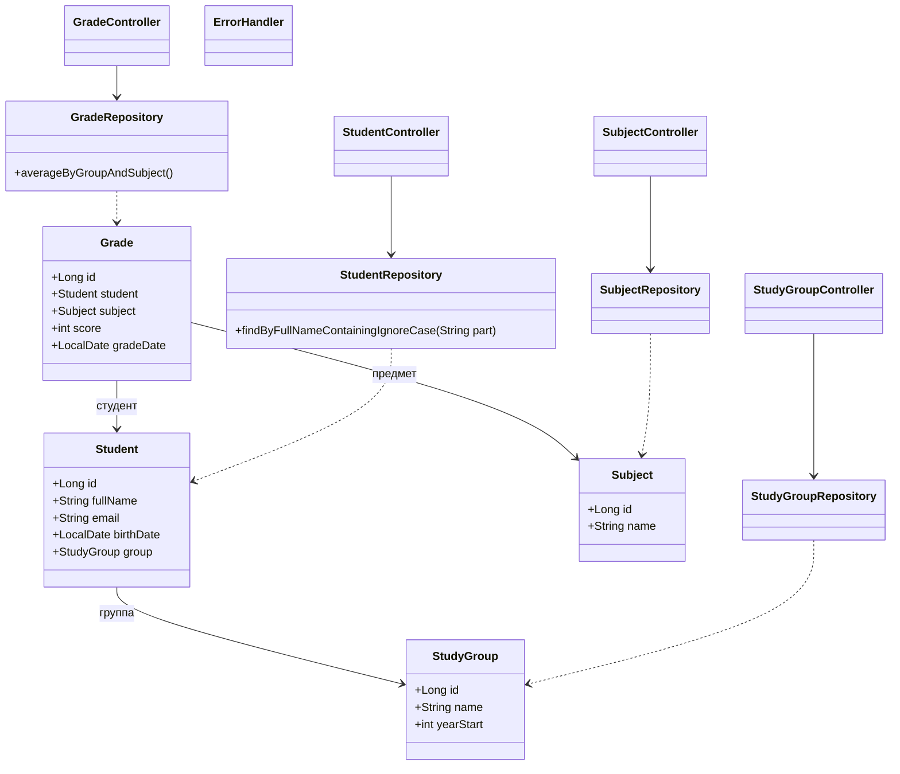

# Учёт студентов и оценок

REST-приложение на Spring Boot. Хранит группы, студентов, предметы и оценки в базе данных H2 и позволяет работать с ними через HTTP-запросы (проверка через Swagger в браузере).

## Технологии

- Java, Spring Boot (Spring Web, Spring Data JPA, Validation)
- База данных H2 (хранится в файле `data/students`)
- Swagger UI (springdoc) для проверки запросов

## База данных

4 связанные таблицы, нормализация до 3NF: данные не дублируются, а таблицы связаны по id.

| Таблица | Назначение | Связи |
|---|---|---|
| `study_groups` | группы (название, год начала) | — |
| `students` | студенты (ФИО, email, дата рождения) | `group_id` → `study_groups` |
| `subjects` | предметы | — |
| `grades` | оценки (1–5, дата) | `student_id` → `students`, `subject_id` → `subjects` |

При удалении студента его оценки удаляются автоматически (`ON DELETE CASCADE`).

### ER-диаграмма



## Диаграмма классов

Запрос проходит путь: контроллер → репозиторий → сущность (таблица).



## Возможности

| Требование | Реализация |
|---|---|
| Полный CRUD | Студенты (`/api/students`) и оценки (`/api/grades`): создание, чтение, изменение, удаление |
| Поиск | `GET /api/students/search?name=ива` — по части ФИО без учёта регистра |
| Отчёт (JOIN + агрегаты) | `GET /api/grades/report` — средний балл (`AVG`) и количество оценок (`COUNT`) по группам и предметам, JOIN четырёх таблиц |
| Валидация ввода | Аннотации `@NotBlank`, `@Size`, `@Email`, `@Past`, `@Min`, `@Max`, `@Pattern`; при ошибке возвращается ответ 400 с текстом |

Группы и предметы: добавление и просмотр (`/api/groups`, `/api/subjects`).

## Запуск

1. Открыть проект в IntelliJ IDEA, дождаться загрузки Maven.
2. Запустить главный класс приложения.
3. Открыть в браузере http://localhost:8080/swagger-ui.html

Таблицы создаются автоматически при первом запуске.

## Пример работы (порядок запросов)

1. `POST /api/groups` — `{"name": "IEMIT-25", "yearStart": 2025}`
2. `POST /api/subjects` — `{"name": "ООП"}`
3. `POST /api/students` — `{"fullName": "Асанова Аэлита", "email": "asanovaa29@gmail.com", "birthDate": "2006-05-03", "group": {"id": 1}}`
4. `POST /api/grades` — `{"student": {"id": 1}, "subject": {"id": 1}, "score": 5, "gradeDate": "2026-11-09"}`
5. `GET /api/students/search?name=аэл` — поиск
6. `GET /api/grades/report` — отчёт

## Структура проекта

```
model/        сущности (таблицы): StudyGroup, Student, Subject, Grade
repository/   работа с БД (Spring Data JPA), SQL-отчёт
controller/   HTTP-запросы (REST API), обработчик ошибок
```